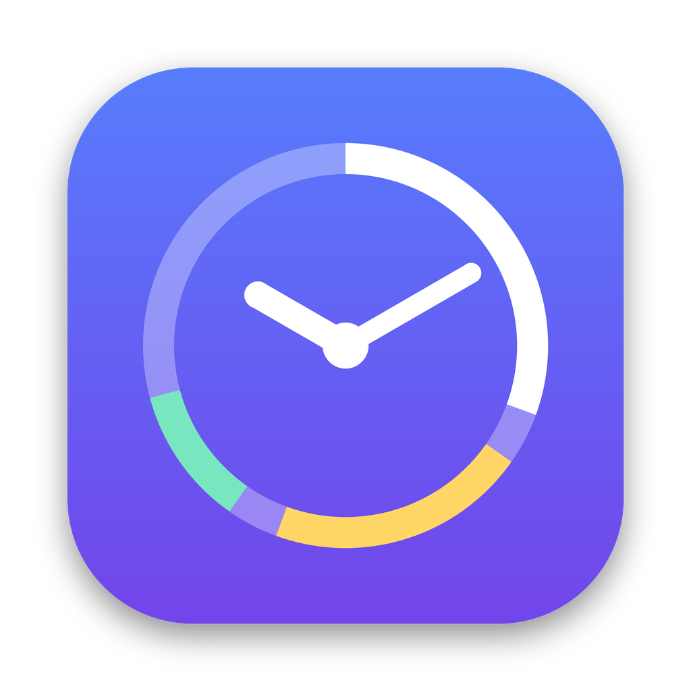

# ActivityTracker

Личный трекер активности для macOS. Живёт в строке меню, плюс у него есть большое окно. Каждые 5 секунд он записывает, чем ты занят: приложение, окно, сайт. По этим данным строится статистика за день, 7, 30, 60, 90, 180 дней, год и всё время. Всё хранится только на этом Mac.



## Возможности

- **В строке меню:** время за компьютером сегодня, по клику — окошко со статистикой.
- **Большое окно:** открывается из Launchpad, из Finder или кнопкой «Окно». Пока оно открыто, значок виден в Dock.
- **Статистика:**
  - почасовой график;
  - сетка «каждая минута дня» (24 × 60 клеток, при наведении видно, что это было);
  - графики по дням и неделям со средней линией;
  - приложения (с самыми частыми окнами), сайты, хронология сессий.
- **Что не считается:**
  - простой (порог настраивается);
  - сон;
  - заблокированный экран.

  Видео и звонки считаются активностью, это можно отключить.
- **Тема:** как в системе, светлая или тёмная.
- **Автообновление** из GitHub Releases. Разрешения macOS при обновлении не слетают.

## Установка

Готовая сборка: **Releases** → последняя `ActivityTracker — сборка N` → `ActivityTracker.zip`. Распакуй и выполни в Терминале:

```bash
xattr -dr com.apple.quarantine ActivityTracker.app
rm -rf /Applications/ActivityTracker.app && mv ActivityTracker.app /Applications/
open /Applications/ActivityTracker.app
```

Из исходников (нужны Xcode Command Line Tools):

```bash
cd ActivityTracker && ./build.sh --install
```

При первом запуске приложение один раз само перезапустится: оно переходит на постоянную локальную подпись. После этого выдай «Универсальный доступ» (чтобы записывались заголовки окон) и разреши «Автоматизацию» для браузеров (чтобы записывались сайты). Дальше обновления приходят сами.

## Приватность

- Все данные лежат только в `~/Library/Application Support/ActivityTracker/activity.sqlite`.
- Единственный сетевой запрос — проверка новой версии на GitHub, раз в 30 минут. Её можно отключить в настройках.

## Документация

| Документ | Что внутри |
|---|---|
| [docs/00 - Обзор](docs/00%20-%20Обзор.md) | что умеет, где что лежит, планы |
| [docs/01 - Архитектура](docs/01%20-%20Архитектура.md) | как устроено: запись, база, отчёты, окна, обновление и подпись |
| [docs/02 - Журнал разработки](docs/02%20-%20Журнал%20разработки.md) | каждый шаг: запросы, решения, ошибки, проверки, коммиты |
| [docs/03 - Решения](docs/03%20-%20Решения.md) | таблица решений и причин |
| [docs/04 - Как сделать](docs/04%20-%20Как%20сделать.md) | установка, обновление, выпуск версии, логи, откат, удаление |

## Разработка

```bash
swift test            # тесты ядра (нужен Xcode)
./build.sh            # собрать .build/ActivityTracker.app
./build.sh --install  # собрать и поставить в /Applications
```

Каждый push в `ActivityTracker/` проверяется на настоящем Mac в GitHub Actions: тесты, сборка, проверка подписи, сквозной тест обновления, замер ресурсов. Push в `main` или `claude/*` после всех проверок публикует релиз.
